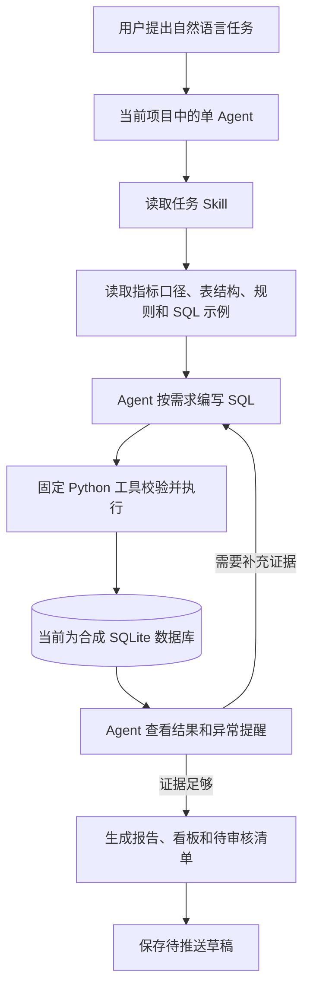

# 印尼直播运营自动化 Demo · 项目交接

更新日期：2026-10-18。项目目录：`/Users/matchalee/Desktop/IDN Workflow`。

## 1. 当前正在做什么

项目目标是演示如何通过自然语言完成印尼直播运营中的重复分析工作，主要包括：

- 周报更新：读取数据、比较周期、监控指标、发现异常后按需下钻。
- 活动复盘：使用同一主播名单和等长窗口，对比活动前后的表现。
- 主播流量助推更新：根据近期表现生成待审核的额度建议与主播清单。

统一关注五项指标：**打赏金额、看播时长、有效直播天数、直播时长、观看观众数**。

当前已经完成第一阶段的本地 Demo，以及旧代码清理。下一阶段的主要缺口是真实数据接入和定时交付。当前数据全部为合成数据，不能将用户履历中“每日减少近四小时工作量”等收益写成 Demo 的实测结果。

## 2. 已确定的架构与工作方式



这里不会每次重新生成 Python 查询脚本。**Agent 将 SQL 和参数交给固定的 `execute_readonly_sql` 工具；执行工具本身保持不变。** SQL 可以参考知识库示例，也可以根据新的分析要求改写。

各部分的职责如下：

| 部分 | 当前职责 |
| --- | --- |
| Agent | 理解问题、读取知识、编写 SQL、查看结果、决定是否继续下钻、解释结论 |
| Skills | 指导周报、复盘、助推等任务的步骤与异常处理分支 |
| 文件知识库 | 保存指标定义、字段与粒度、关联方式、业务规则和 SQL 示例 |
| Python 工具 | 连接数据库、准备任务范围、质量检查、SQL 访问限制、结果校验、证据保存与报告导出 |
| 数据库 | 执行 SQL，计算指标、差值和规则提醒 |

仍有部分固定逻辑属于执行基础设施，例如任务窗口准备、日期与名单限制、结果契约验证。不能描述成“所有规则都已移出 Python”。

**自然语言入口是当前项目的 Agent 聊天。** `run-plan` 仅重放已经保存的 SQL 计划，不调用模型；网页工作台是结果导航，没有独立聊天后端。

## 3. 已完成的内容

| 能力 | 当前完成情况 |
| --- | --- |
| 业务主线调整 | 已从早期支付诊断和人群分层，调整为周报、活动复盘和主播助推 |
| 指标知识库 | 已沉淀五项指标口径、逻辑数据源、业务规则和 SQL 示例 |
| Skill 路由 | 已提供周报、复盘、助推、指标问数、质量检查、异常监控、下钻与报告 Skills |
| 周报异常分支 | 已明确：整体或层级触发提醒后，Agent 读取监控和下钻 Skills，按需要追加 SQL |
| 动态 SQL 执行 | 已接受 Agent 编写的 SQL，并保留提交 SQL、实际限定范围后的 SQL、参数和查询结果 |
| 只读访问限制 | 已实现语法树检查、来源和函数限制、日期与名单约束、超时及结果行数限制 |
| 数据质量 | 已检查关联、日期覆盖、支付对账、主播开播与助推日志完整性；失败时阻断交付 |
| 指标结果验证 | 已检查结果字段、数值、差值及跨查询勾稽；多事实明细直接 JOIN 会被拒绝 |
| 报告与看板 | 已生成 Markdown、JSON、HTML；助推流程另生成待审核 CSV |
| 证据追溯 | 每次调用保存证据；数据快照和知识版本不一致时不能混入新报告 |
| 计划重放 | 已支持保存 SQL 计划并重放；同一运行的相同输入可复用完成产物 |
| 最简单固定查询 | 已保留指定日期范围打赏总金额的 Python 示例 |
| 旧代码清理 | 已删除旧固定业务实现、兼容入口、专用测试及失效分层 Skill，并提取公共校验与看板导航 |

指标注意事项：期间观看 UV 要整体去重，不能把每日或各主播 UV 相加；有效直播天数在人群汇总时是“主播日”；看播时长与直播时长是不同指标。阈值和配额目前都是可调整的 Demo 假设。

### 保留的固定查询

[simple_query.py](</Users/matchalee/Desktop/IDN Workflow/liveops/simple_query.py>) 中保留一条固定业务 SQL：查询指定日期范围内的成功打赏金额。这个示例每次只换日期参数。

数据库连接、元数据读取和质量检查中仍有固定 SQL，它们用于基础设施校验。周报、复盘和助推的业务分析使用 Agent 提交的 SQL。

### 本次已移除的旧内容

项目的 `liveops` 目录已删除早期的 `analytics.py`、`operations.py`、`metrics.py`、`mock.py` 和 `workflows.py`；旧专用测试、`LegacyToolRegistry`、`legacy-workflow` 命令和 `audience-segmentation` Skill 也已移除。

公共能力现由 `validation.py`、`knowledge.py`、`workspace.py` 等模块承担。当前仍使用 `ops_mock.py` 生成运营合成快照。历史数据和报告保留，但旧工具名称不能再用于重放。

## 4. 还没有完成的内容

| 项目 | 当前缺口 | 后续需要补充 |
| --- | --- | --- |
| 真实内部数据库 | 当前仅支持合成 SQLite 快照 | 确认数据库类型、只读连接方式、真实表结构、权限和数据覆盖范围 |
| Hive 等 SQL 方言 | 当前查询与检查按 SQLite 方言实现 | 适配连接器、逻辑数据源映射、语法树检查和 SQL 示例，并重新核对口径 |
| 定时触发 | 尚未配置调度任务 | 确定业务时区、运行频率、数据就绪条件和失败处理方式，再接调度器 |
| 实际消息推送 | 当前只生成 `delivery_draft.json` | 确定通知渠道、接收对象和发送方式；当前草稿未发送 |
| 实际流量下发 | 当前只生成建议 CSV | 明确审核与执行流程，接入实际分配系统，并记录下发结果 |
| 独立运行的模型入口 | 当前依赖项目 Agent 聊天 | 如需独立服务或网页聊天，另行接入模型调用、会话管理和工具调度 |
| 自然语言效果评估 | 已验证工具与 SQL 示例，未完成独立自然语言盲测 | 用未预先提供答案的问题评估任务理解、SQL 正确性与下钻选择 |
| 真实业务口径确认 | 当前为演示规则 | 与业务方确认有效直播门槛、异常阈值、活动名单和助推策略 |
| 实际提效验证 | 未测量人工与自动流程耗时 | 在真实流程中记录耗时、复核成本、失败率与节约工时 |
| 代码版本交付 | 当前项目文件在 Git 中仍显示为未跟踪 | 如需团队交接，再整理提交与仓库交付；本轮未提交或推送 |

真实数据接入需要修改当前对“合成快照”的限定及质量检查假设，不能只替换连接字符串。访问限制保护当前数据库工具连接，并不构成对宿主 Agent 所有文件或工具能力的生产隔离。

SQL 能成功执行、结果字段能通过校验，都不能自动证明业务语义正确。新增指标或复杂关联仍需要独立查询、样本对照或人工复核。

付费作弊识别、核心大 R 分层、主播流失预测及 AB 实验暂不属于当前实现主线；原方案中提到它们，不代表它们仍是已完成能力或下一步必做任务。多 Agent 编排也未实现，当前阶段继续使用单 Agent。

## 5. 接手时优先看哪些文件

| 文件或目录 | 用途 |
| --- | --- |
| [AGENTS.md](</Users/matchalee/Desktop/IDN Workflow/AGENTS.md>) | 当前项目规则、任务路由和执行约束 |
| [README.md](</Users/matchalee/Desktop/IDN Workflow/README.md>) | 安装、入口和最简使用方法 |
| [运营流程说明](</Users/matchalee/Desktop/IDN Workflow/docs/OPERATIONS_WORKFLOW.md>) | 完整业务链路和状态文件说明 |
| [SQL 计划格式](</Users/matchalee/Desktop/IDN Workflow/docs/SQL_PLAN_FORMAT.md>) | SQL 计划如何保存与重放 |
| [knowledge](</Users/matchalee/Desktop/IDN Workflow/knowledge/README.md>) | 指标、表结构、规则及示例 SQL 的入口 |
| [统一配置](</Users/matchalee/Desktop/IDN Workflow/config/operations_metrics.json>) | 有效直播、异常提醒、助推门槛和配额 |
| [skills](</Users/matchalee/Desktop/IDN Workflow/skills>) | 任务指引的实际文件；`.agents/skills` 为发现链接，不维护两份内容 |
| [examples/sql_plans](</Users/matchalee/Desktop/IDN Workflow/examples/sql_plans>) | 三个可重放计划及一个下钻 SQL 示例 |
| [当前验证说明](</Users/matchalee/Desktop/IDN Workflow/docs/ACCEPTANCE.md>) | 验证范围和未验证边界 |
| [原始方案](</Users/matchalee/Desktop/IDN Workflow/印尼workflow方案.md>) | 需求来源；正文含历史设计，实施状态以当前代码和本交接为准 |

当前 Python 模块分工：

| 模块 | 用途 |
| --- | --- |
| [__main__.py](</Users/matchalee/Desktop/IDN Workflow/liveops/__main__.py>) | 命令行入口：初始化、工具调用和计划重放 |
| [tools.py](</Users/matchalee/Desktop/IDN Workflow/liveops/tools.py>) | 工具注册、参数检查、运行与证据记录 |
| [sql_tools.py](</Users/matchalee/Desktop/IDN Workflow/liveops/sql_tools.py>) | Agent 可调用的查询、汇总、导出和待推送工具 |
| [knowledge.py](</Users/matchalee/Desktop/IDN Workflow/liveops/knowledge.py>) | 读取知识与配置，计算知识版本 |
| [sql_guard.py](</Users/matchalee/Desktop/IDN Workflow/liveops/sql_guard.py>) | SQL 语法树、来源和访问范围限制 |
| [store.py](</Users/matchalee/Desktop/IDN Workflow/liveops/store.py>) | 只读连接、执行限额和查询日志 |
| [validation.py](</Users/matchalee/Desktop/IDN Workflow/liveops/validation.py>) | 数据质量、日期和主播范围校验 |
| [sql_analysis.py](</Users/matchalee/Desktop/IDN Workflow/liveops/sql_analysis.py>) | 准备任务上下文、校验结果契约、汇总证据 |
| [report.py](</Users/matchalee/Desktop/IDN Workflow/liveops/report.py>) | 将证据生成报告、HTML 和助推 CSV |
| [workspace.py](</Users/matchalee/Desktop/IDN Workflow/liveops/workspace.py>) | 更新三个流程的看板导航 |
| [plan_runner.py](</Users/matchalee/Desktop/IDN Workflow/liveops/plan_runner.py>) | 重放已保存的 SQL 计划，管理状态与失败记录 |
| [simple_query.py](</Users/matchalee/Desktop/IDN Workflow/liveops/simple_query.py>) | 保留的最简单固定业务查询 |
| [ops_mock.py](</Users/matchalee/Desktop/IDN Workflow/liveops/ops_mock.py>) | 生成当前合成数据；普通业务分析时不能把生成逻辑当证据 |

## 6. 如何继续运行

当前工作区已有 `.venv`，依赖为 Python >= 3.10 和 `requirements.txt` 中固定版本的 SQLGlot。当前合成快照覆盖 **2026-09-01 至 2026-10-17**，业务时区为 **Asia/Jakarta**。用户问“昨天”“上周”时先核对覆盖范围，不能静默换成一个有数据的日期。

在新环境中安装：

```sh
cd "/Users/matchalee/Desktop/IDN Workflow"
python3 -m venv .venv
.venv/bin/python -m pip install -r requirements.txt
.venv/bin/python -m liveops tools
```

`data/operations-v2` 已有快照，无需重复初始化。`init` 会拒绝覆盖已有快照。

运行固定查询：

```sh
.venv/bin/python -m liveops.simple_query --start-date 2026-10-11 --end-date 2026-10-17
```

在项目 Agent 聊天中体验自然语言任务：

> 根据业务知识库更新截至 2026-10-17 的周报，展示所用 SQL，发现异常时按需要下钻并生成看板。

重放现有 SQL 计划：

```sh
.venv/bin/python -m liveops run-plan --plan-file examples/sql_plans/weekly_report.json
.venv/bin/python -m liveops run-plan --plan-file examples/sql_plans/campaign_review.json
.venv/bin/python -m liveops run-plan --plan-file examples/sql_plans/traffic_boost_update.json
```

直接调用工具时，SQL 和参数保存为 JSON 文件，再通过 `--args-file` 传入。一次任务复用同一 `run_id`；任务输入、知识或数据改变后使用新的运行 ID。不要绕过执行工具直接对数据库运行临时脚本。

当前工具链：`get_data_profile` → `read_business_knowledge` → `prepare_analysis` → `execute_readonly_sql` → 按需补充查询 → `assemble_analysis` → `export_report` → `prepare_delivery`。`check_data_quality` 可单独调用，`get_metric_dictionary` 提供知识契约，`query_gift_total` 是固定查询例子。

## 7. 已有产物与验证状态

[运营工作台](</Users/matchalee/Desktop/IDN Workflow/outputs/operations/index.html>) 提供最新三个完成任务的入口。交接时已核对以下产物存在，状态为完成，知识版本与当前知识库一致：

- [周报看板](</Users/matchalee/Desktop/IDN Workflow/outputs/runs/sql-weekly-demo/report-6a6ccf5f1767/report.html>)。
- [活动复盘看板](</Users/matchalee/Desktop/IDN Workflow/outputs/runs/sql-campaign-demo/report-06148b3f2e60/report.html>)。
- [主播助推看板](</Users/matchalee/Desktop/IDN Workflow/outputs/runs/sql-boost-demo/report-70ea255eb4e0/report.html>)及[待审核 CSV](</Users/matchalee/Desktop/IDN Workflow/outputs/runs/sql-boost-demo/report-70ea255eb4e0/traffic_boost_candidates.csv>)。

每个运行目录保存工具证据、SQL、报告与 `delivery_draft.json`。当前交付状态为 `draft_not_sent`，没有真实发送。

交接核验：已重新运行当前测试，检查动态指标与独立源表查询、三个计划导出、固定查询、权限与质量门禁、配置变更失效、命令行入口及快照不覆盖。测试详情见当前验证说明；不将测试结果当作自然语言理解效果或业务收益证明。

复验命令：

```sh
.venv/bin/python -m unittest discover -s tests -v
```

已有 HTML 的文件与链接已核验。最近一次浏览器目视检查因内置浏览器对 `file://` 的协议限制未完成，不能声称最新页面已经完成视觉验收。

## 8. 建议接手顺序

1. 阅读本文件、AGENTS.md 和知识库，确认继续保持“Agent 写 SQL、固定工具执行”的方向，并保留固定查询示例。
2. 先完成当前三个本地流程的演示；若目标仍是学习和展示，可优先增加新的自然语言案例与人工核对记录。
3. 若目标转向内部实际使用，先确认数据库、真实表与指标口径，完成只读接入和结果对账。
4. 真实查询稳定后，再确定调度时间与消息渠道，接入失败处理、推送和实际运行记录。
5. 最后按真实使用情况评估提效，记录复核成本和限制。

以上为建议顺序，不代表已配置定时任务或已开始外部系统接入。后续新增任务以用户的下一步要求为准。
