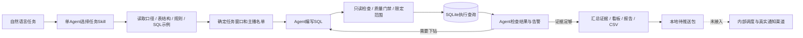

# 运营自动化：知识库驱动的Agent SQL流程

## 主线

Agent按Skills读取文件知识库，选择任务、编写SQL、根据结果决定下钻。数据库执行SQL决定业务数值；Python负责连接、访问边界、质量检查、结果验证和报告。唯一固定业务查询是liveops/simple_query.py的指定期间打赏金额，作为学习/对照例子。旧固定业务工具及兼容入口已删除。

未连接真实内部系统。原始SQL、工具注入范围后的实际SQL、参数、快照、knowledge_id和结果保留在证据文件。run-plan只重放Agent已保存的SQL计划，不调用模型，不作为自然语言能力证明。

## 数据源

| 表 | 作用 |
| --- | --- |
| view_sessions | 用户-主播观看会话，计算看播时长和期间去重观众 |
| transactions | 成功打赏记录，计算打赏金额 |
| streamer_daily | 单主播单日实际直播秒数，包含不开播的零记录 |
| campaigns / campaign_streamers | 活动窗口和冻结主播名单 |
| traffic_boost_daily | 历史助推分配快照，用来生成额度差值 |
| users / streamers / payment_attempts | 关联维度和支付对账校验 |

主播日志和助推快照需按全主播全日期完备覆盖，不能把缺日志当未开播。观看会话必须关联当日实际开播记录，单会话不能长于主播直播时间。

Agent只查询knowledge/schema.json中的逻辑数据源：watch_events、gift_events、broadcast_days、streamer_profiles、boost_snapshots、campaign_members。工具自动加日期/名单筛选，不允许直接访问物理表或用户明细；viewer_id只能COUNT(DISTINCT viewer_id)。

## 共享指标

五项指标定义从knowledge/metrics.json读取，任务规则见knowledge/rules.md，阈值只来自config/operations_metrics.json。Agent据此写SQL。有效天数按主播日计算，期间UV整体去重，看播与开播时长分开。各事实表先聚合，避免JOIN放大。

默认阈值与配额均为可修改Demo假设。知识或配置改变会改变knowledge_id，报告拒绝旧知识证据。SQL只读和结果形状检查不自动证明业务语义正确，需独立查询/已核对示例验证。没有退款、成本账和随机分组，所以不输出ROI、真实毛利或AB因果收益。

## 三个任务的区别

- 周报：截至日往前七天对前七天；默认全主播，可筛层级；返回整体与层级的五指标变化和规则提醒。
- 活动：按活动配置日期，使用同一名单的活动前等长窗口；输出前后对比和层级拆解。
- 助推：截至日近七天筛选主播，与昨日额度比较；生成建议增/减/保持和原因。建议不写回源表、不下发流量。
- 自助问数：prepare_analysis(workflow=ad_hoc,start_date,end_date)允许按用户指定范围写新SQL；单项结果可直接回答或导出，不必构造完整周报。

## 执行状态

每次调用保存eXXXX.json。prepare_analysis保存上下文，execute_readonly_sql保存SQL与结果，assemble_analysis保存引用链，export_report渲染，prepare_delivery才生成workflow_state.json和待推送包。质量失败不生成交付。

run-plan另存agent_plan.json和plan_request.json；同run_id、同计划/SQL/快照/知识重放复用完成产物，失败保存plan_failure.json并要求新ID重试。直接多次调用工具会新增证据，不冒称所有交互均幂等。计划格式见SQL_PLAN_FORMAT.md。

delivery_draft.json保存任务标题、日期范围、报告/CSV路径和draft_not_sent状态；destination与scheduled_at为null。真实通知与定时任务没有配置，不安装任何后台计划任务。后续接入时应补实际系统/时间/渠道/权限和审核约定。

工作台outputs/operations/index.html提供三个最新完成任务的看板导航，页面本身不提供独立LLM聊天服务。用户可在当前项目聊天按自然语言触发。
