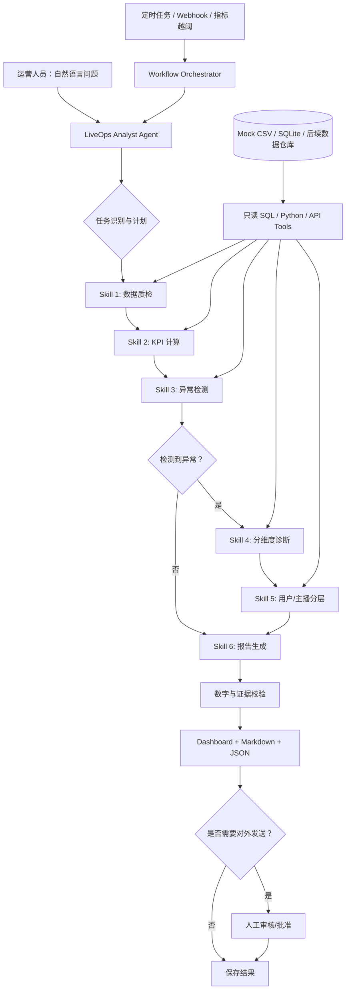

# 当前实施方向更新（2026-10-18）

按用户补充的工作经历，本项目当前主线调整为：**周报更新、活动复盘、主播流量助推更新的自动化提效**。三类任务统一监控**打赏金额、看播时长、有效直播天数、直播时长、观看观众数**。当前架构为**Skills定义任务步骤、文件知识库保存口径/表结构/规则/SQL示例、Agent编写SQL、受控只读工具执行、固定程序生成看板与待推送包**。保留一个最简单固定Python业务查询：指定期间打赏金额。

当前可执行版本与指标口径以README.md、knowledge/、docs/OPERATIONS_WORKFLOW.md和config/operations_metrics.json为准；下文保留原始完整设计作为历史参考。当前未接真实内部系统、定时器和外部推送，用户经历中的工时节约并非Demo实测结果。支付诊断、异常打赏识别和流失预测不再是默认演示主线。

---

# 快手印尼直播业务｜Agent + Skills + Workflow 自动化数据分析实施方案（原始设计）

> **版本：v1.0｜2026-10-18**  
> **项目定位：** 用 100% 合成数据复现直播业务的自动化分析工作流，用于学习、作品展示及面试 Demo。该方案不代表快手内部实际系统架构或业务指标口径。  
> **部署原则：** **不局限于本地离线**；可由 Codex、Claude Code 等支持文件工具 / Skills 的 Agent 调用，也可基于 n8n、LangGraph、OpenAI Agents SDK 构建云端或本地 Agent 服务。  
> **当前状态：** 已有一版 Python + SQLite 可运行 Mock Demo，**本文件是将其升级为 Agent/Skills/Workflow 架构的实施设计**；下文所述 Agent Skill、MCP 接口及云端编排**尚未实现**。

---

## 1. 业务问题与项目目标

### 1.1 模拟的业务场景

印尼直播运营团队需要每天监控直播流量、付费和 GMV。人工工作通常需要重复完成：

1. 从多张数据表取数、清洗与对齐口径；
2. 更新每日 KPI、主播和用户分层；
3. 发现 GMV、付费人数或支付成功率的异常；
4. 按日期、设备、渠道、用户群体下钻排查；
5. 整理日报和建议，交给运营人员审核。

**期望效果：** 让常规取数、指标计算、规则检测和报表生产自动化，把人工精力集中在异常判断、业务解释与行动决策上。

### 1.2 三种触发方式

- **对话触发（Agent）：** “帮我分析 2026-10-15 印尼直播业务为什么支付表现下降，并给出证据。”
- **定时触发（Workflow）：** 每天指定时间自动更新 KPI、异常告警和日报；具体时区与调度时间由部署者配置。
- **事件触发（Workflow → Agent）：** 指标越过阈值后，自动调用 Agent 进行指定维度的诊断，产出待审核结论。

### 1.3 最终交付物

- 可复用的 **Agent Skills**（包含 `SKILL.md`、脚本、指标定义和模板）；
- 可执行的 **Workflow**（带条件分支、错误处理、日志与报告输出）；
- 一个可对话的 **LiveOps Analyst Agent**；
- Mock CSV / SQLite 数据、指标字典、异常事件、测试用例；
- Dashboard、结构化异常清单、业务分析报告和执行记录。

---

## 2. Workflow、Skill 和 Agent：各自做什么？

| 组件 | 角色 | 在本项目中的职责 | 不应该负责 |
|---|---|---|---|
| **Workflow** | 确定性流程编排 | 定时/事件触发、执行步骤、条件分支、失败重试、日志、交付 | 擅自生成或修改指标口径 |
| **Skill** | 可复用的业务能力包 | 包装 SQL、数据质检、异常检测、归因分析模板、报告规范 | 仅靠 Markdown 就宣称具备实际计算能力 |
| **Tool / MCP / API** | 实际执行接口 | 查数据库、运行白名单 SQL、调用 Python、保存报表 | 不加校验地执行任意命令或写入数据 |
| **Agent** | 任务理解与决策 | 理解自然语言、选择 Skill/Tool、决定下钻路径、总结证据 | 在没有数据计算的情况下编造 KPI、确定因果关系 |

**核心原则：Agent 决定“分析什么、下一步查什么”；代码/SQL 决定“数值是多少”；Workflow 保证“步骤按规则可靠执行”。**

### 2.1 推荐路线

**首选：Agent + Skills + 确定性 Workflow（混合架构）**。

- 第一阶段用 **单 Agent + Skills + Python 工具** 演示自然语言分析，改造成本最小。
- 第二阶段接 **n8n** 做可视化调度 / 报警，或用 **LangGraph** 做有状态分支 / 人工审批。
- 不建议一开始拆成多 Agent：多 Agent 会增加工具协调、状态同步、调试和费用，当前业务体量没有必要。

---

## 3. 目标架构



**架构说明：** 图中的箭头表示建议的业务依赖。对话中只问单一 KPI 时，无需执行整条链路；由 Agent 调用对应 Skill/Tool 即可。完整日报则走完整 Workflow。外部发送、修改业务数据和其他高影响操作要走人工审批。

### 3.1 两条主要用户旅程

**旅程 A：每日自动日报**

```text
Scheduler（Asia/Jakarta，时间可配置）
  → ingest / refresh（取数）
  → data_quality（质量门禁）
  → calculate_kpi（SQL 指标计算）
  → anomaly_detection（历史基线判断）
  → [异常存在？]
     ├─ 否：简版日报
     └─ 是：drilldown → segmentation → AI evidence summary
  → validate_report（数字复核）
  → export Markdown / HTML / JSON
  → [需要推送？] → 人工审核 → 发布
```

**旅程 B：Agent 自助问数与诊断**

```text
用户：“10 月 15 日为什么支付成功率下降？”
  → Agent 解析时间、业务范围、目标指标
  → 读取 metric_dictionary（指标字典）
  → 工具计算 10 月 15 日支付成功率及历史基线
  → 检测异常
  → Agent 选择 Android / iOS、渠道维度继续下钻
  → 输出「现象—证据—可能原因—未验证因素—下一步行动」
  → 附 SQL 查询 ID / 指标口径 / 数据时间
```

> 只有单日对比与维度差异时，最多说“发现与支付下降一致的端别异常线索”；不能声称已经证明“Android 故障导致整体营收下降”。需要更多证据才能作因果归因。

---

## 4. Mock Data：直接复用已有 Demo

现有项目在 `kuaishou_liveops_demo/`，使用固定随机种子 `20261018` 生成 2026-09-20 至 2026-10-17 的 **28 天**模拟数据。

| 表 / 文件 | 已有样本量 | 字段用途 |
|---|---:|---|
| `users.csv` | 4,000 用户 | 注册、地区、设备、获客渠道 |
| `streamers.csv` | 60 主播 | 主播层级、内容类别 |
| `view_sessions.csv` | 39,016 观看会话 | 观看时长、观看用户、关注行为 |
| `payment_attempts.csv` | 7,024 支付尝试 | 支付成功/失败、设备、金额 |
| `transactions.csv` | 6,597 成功交易 | GMV、付费 UV、ARPPU |
| `synthetic_incidents.csv` | 预设事件说明 | **仅用于验收评测，不进入 Agent 的正常分析上下文** |

**事件 1｜2026-10-13：疑似异常高额流水**

- 在 Mock 数据中注入 48 位关联设备、高频大额的合成用户；
- 用于测试 `Gross GMV` 与 `Trusted GMV（演示口径）` 的差异；
- `risk_user` 仅表示 **规则命中 / 待人工复核**，不是“已证实欺诈”。

**事件 2｜2026-10-15：Android 支付成功率下降**

- 模拟观看流量增长，但 Android 端支付成功率大幅下滑；
- 用于验证 Agent 能否先识别全局异常，再定位到设备维度，并给出进一步调查建议。

### 4.1 指标字典必须固定

| metric_key | 定义 | 注意 |
|---|---|---|
| `gross_gmv_idr` | `SUM(successful_transactions.amount_idr)` | 仅成功支付流水 |
| `suspicious_gmv_idr` | 命中风险规则用户对应的成功支付金额 | 规则命中 != 已证实作弊 |
| `trusted_gmv_idr` | `gross_gmv_idr - suspicious_gmv_idr` | 仅为演示/分析口径，非财务结算额 |
| `active_uv` | 当日观看去重用户数 | 需要指定日期和时区 |
| `paying_uv` | 当日成功支付去重用户数 | 以成功交易为准 |
| `payer_conversion` | `paying_uv / active_uv` | 需检查付费集合与观看集合口径一致性 |
| `payment_success_rate` | 成功支付尝试数 / 总支付尝试数 | 与付款 UV 转化率不同 |
| `arppu_idr` | 成功支付总金额 / 付费 UV | 输出 IDR 单位 |

**强制规则：** KPI 必须由 SQL/Python 计算；LLM 只能读取结构化结果进行解释，不得自行心算或“补齐”缺失值。

---

## 5. Skill 设计与分工

建议 **6 个业务 Skills**，另设统一的 Tool 层、指标字典和安全策略。每个 Skill 不是单纯一段 Prompt，而是：**触发描述 + 执行指引 + 受控脚本/接口 + 输入输出契约 + 验收样例**。

| Skill | 何时调用 | 输入 | 主要输出 | 计算方式 |
|---|---|---|---|---|
| `data-quality-check` | 更新数据后 / 分析前 | `data_source`, `date_range` | 质量检查 JSON、异常字段清单 | Python/SQL，确定性 |
| `business-kpi-analysis` | 用户问 KPI / 日报 | 时间、范围、指标 | KPI JSON、对比表、SQL ID | SQL，确定性 |
| `anomaly-monitoring` | 需要异动监控 | KPI 时间序列、阈值规则 | 告警、基线、严重级别 | Python，确定性 |
| `root-cause-drilldown` | KPI 异常或追问为什么 | 告警、允许维度、数据快照 | 贡献拆解、候选线索、验证缺口 | SQL + Agent 决策 |
| `audience-segmentation` | 问高价值用户/主播 | 用户/主播指标、规则版本 | 分层计数、分层流水、观察 | SQL/Python |
| `business-report-writing` | 需要日报 / 复盘 | 验证过的结构化分析结果 | Markdown / JSON / Dashboard 摘要 | 模板 + LLM（可选） |

### 5.1 Skill 的目录规范

参考开放的 Agent Skills 规范：每个 Skill 文件夹至少包含一个 `SKILL.md`（YAML frontmatter + Markdown 指令），可选 `scripts/`、`references/`、`assets/`。`name` 和 `description` 是必要元数据；**Skill 指令不等于工具执行权限**，Agent 所处环境必须具备实际脚本、数据库或 API 访问能力。

```text
liveops-agent/
├── AGENTS.md                         # 面向 Agent 的全局规则（具体平台按需适配）
├── skills/
│   ├── data-quality-check/
│   │   ├── SKILL.md
│   │   └── scripts/check_quality.py
│   ├── business-kpi-analysis/
│   │   ├── SKILL.md
│   │   ├── scripts/calculate_kpi.py
│   │   └── references/metric_dictionary.md
│   ├── anomaly-monitoring/
│   │   ├── SKILL.md
│   │   └── scripts/detect_anomaly.py
│   ├── root-cause-drilldown/
│   │   ├── SKILL.md
│   │   └── references/drilldown_playbook.md
│   ├── audience-segmentation/
│   │   ├── SKILL.md
│   │   └── scripts/segment_users.py
│   └── business-report-writing/
│       ├── SKILL.md
│       └── assets/daily_report_template.md
├── tools/
│   ├── sql_readonly.py               # 参数化只读查询与权限控制
│   └── tool_registry.py              # 向 Agent 暴露受控工具
├── workflows/
│   ├── daily_report.py               # 先用 Python 明确依赖
│   └── daily_report_n8n.json          # 未来 n8n 导出的可选定义
├── data/                              # Mock CSV / SQLite
├── outputs/                           # Dashboard、JSON、Markdown
├── tests/                             # SQL/Skill/Agent 集成测试
└── README.md
```

> 注意：`daily_report_n8n.json` 是**拟建文件**，不是当前已经生成好的 n8n 工作流；不同 Agent 平台加载 Skill 的路径和权限设置可能不同。

### 5.2 SKILL.md 范例：业务指标分析

文件：`skills/business-kpi-analysis/SKILL.md`

```markdown
---
name: business-kpi-analysis
description: Analyze live-streaming business KPIs such as GMV, active UV, paying UV, ARPPU and payment success rate. Use when a user asks for metrics, trends, comparisons or KPI changes.
---

# Business KPI Analysis

## Preconditions
- Read `references/metric_dictionary.md` before running analysis.
- Use only approved read-only SQL/Python tools.
- Require an explicit reporting timezone and date range.

## Steps
1. Parse requested metrics, dates, scope and comparison period.
2. Look up definitions in the metric dictionary.
3. Run `scripts/calculate_kpi.py` through an available authorized tool.
4. Verify non-null metrics, denominator validity and totals.
5. Return values with units, baseline dates and query reference IDs.

## Output
Return JSON fields: date_range, timezone, filters, metrics, comparisons,
query_ids, data_freshness, warnings.

## Constraints
- Do not invent values.
- Do not silently change metric definitions.
- Do not interpret anomalies as proven causes.
```

### 5.3 SKILL.md 范例：异常诊断（真正体现 Agent 价值）

文件：`skills/root-cause-drilldown/SKILL.md`

```markdown
---
name: root-cause-drilldown
description: Diagnose abnormal changes in live-streaming KPIs using structured drilldowns across platform, acquisition channel, streamer tier and user segment. Use after anomaly detection or when a user asks why a KPI changed.
---

# Root Cause Drilldown

## Decision process
1. Confirm the metric, baseline, magnitude and data-quality status.
2. Choose up to three approved drilldown dimensions relevant to the metric.
3. Call read-only tools to compute each dimension's KPI and contribution.
4. Separate observations, hypotheses and missing evidence.
5. Stop when evidence is sufficient or the investigation budget is reached.

## Output
- observation: confirmed facts with values and time range
- drilldowns: structured comparisons and query IDs
- hypotheses: candidate explanations, not confirmed causality
- next_checks: suggested verification steps
- limitations: missing data or insufficient evidence

## Guardrails
Never assert causality from a simple correlation or day-over-day change.
Never query PII or raw user-level records unless explicitly authorized.
```

### 5.4 Tool 输入输出建议（与 Skill 解耦）

例如所有运行环境统一暴露下列受控调用，不让 LLM 任意拼接执行 shell：

```python
get_metric_dictionary() -> dict
query_kpis(start_date: str, end_date: str, metrics: list[str], filters: dict) -> dict
get_dimension_breakdown(date: str, metric: str, dimension: str) -> dict
detect_anomalies(start_date: str, end_date: str, rule_version: str) -> dict
get_risk_summary(date: str) -> dict
export_report(analysis_id: str, format: str) -> dict
```

统一响应至少包括：`run_id`、`status`、`data_as_of`、`metric_version`、`rows` / `metrics`、`warnings`、`query_ids`。对无法确认的数据返回 `unknown` 与原因，而不是生成估计值。

---

## 6. Workflow 细化：什么是确定性的，什么给 AI？

| 节点 | 执行者 | 失败处理 |
|---|---|---|
| 触发与取数 | Workflow + 数据 Tool | 重试有限次数；记录来源和数据时间 |
| Schema / 完整性校验 | Python | 严重失败时阻止下游，禁止继续出日报 |
| KPI 与风险规则计算 | SQL / Python | 记录规则版本、校验勾稽关系 |
| 时间序列异常检测 | Python | 样本不足则标记“无法形成基线” |
| 选择下钻维度 | Agent（白名单内） | 超时/超预算则降级为固定维度报告 |
| 下钻计算 | SQL / Python | 查询只读、行数限制、查询超时 |
| 结论整理 | Agent | 必须引用计算证据；不允许臆造根因 |
| 报表渲染 | 确定性模板，LLM 仅写文字 | 校验数字、空值、日期和单位 |
| 发布 / 发送 | Workflow + Human approval | 未审批只保存草稿，不主动推送 |

### 6.1 有状态任务的数据结构

```json
{
  "run_id": "demo-20261015-001",
  "trigger": "chat",
  "market": "ID",
  "timezone": "Asia/Jakarta",
  "date_range": ["2026-10-15", "2026-10-15"],
  "metric": "payment_success_rate",
  "metric_version": "v1",
  "baseline": {"method": "prior_7d_median", "include_current_day": false},
  "quality_status": "passed",
  "anomalies": [],
  "drilldowns": [],
  "hypotheses": [],
  "human_approved": false,
  "report_path": null
}
```

**关键：** 历史基线不应包含当天；小样本或 0 分母要显式告警。`human_approved=false` 时，报告只能保存为内部草稿。

### 6.2 Agent 的分析策略

在 `root-cause-drilldown` 中，推荐按以下顺序排查：

1. **排数据问题**：漏数、延迟、日期时区、重复数据、状态回填；
2. **拆指标链路**：观看用户 → 发起支付 → 支付成功 → 支付金额；
3. **拆维度**：Android/iOS、渠道、主播层级、用户分层；
4. **量化贡献**：整体下降多少、各维度贡献多少、分母是否改变；
5. **形成结论**：已证实的现象、合理假设、需要额外验证的证据。

异常优先级可以综合 **偏离程度 × 业务影响 × 数据可靠度**，但应由可解释规则计算，Agent 不应自行凭空给出高精度风险概率。

---

## 7. 三种落地路径：不限制本地离线

| 方案 | 使用方式 | 适用目标 | 主要代价 | 推荐程度 |
|---|---|---|---|---|
| **A. Codex / Claude Code + Skills** | 在 Agent 环境放入 Skill 包；调用 Python/SQL 工具 | 快速做对话式分析 Demo、展示 Skills 复用 | 运行依赖 Agent 的文件/脚本权限；定时调度要另外接 | **优先做** |
| **B. n8n + Agent / API Tools** | 用可视化节点连接定时器、Python API、LLM、通知 | 展示业务 Workflow、自动日报、条件分支 | 需要部署 n8n 和可调用的数据服务 | **第二阶段** |
| **C. LangGraph / Agents SDK** | 用 Python 定义 Agent、工具、状态、审批和回退 | 复杂分支、长期运行、生产风格 Agent | 编码、调试与维护工作更多 | **增强版** |

### A. 最快实现：Agent 原生 Skills

**运行流程：** 把项目放到 Agent 可访问的工作区 → 配置 Skill 发现路径 → Agent 读取 `SKILL.md` → 通过受控工具执行 Python / SQL → 读取 JSON → 输出业务解释。

- **优点**：最直接体现“自然语言指令 → 动态选择 Skill → 工具执行 → 结构化业务结论”。
- **模型**：可使用支持工具调用的云端模型；如果 Agent 运行环境允许，也可接本地或自托管模型。
- **限制**：不是所有聊天界面都能直接访问你的 Mac 文件；Agent 必须有工作区、可用工具或远程 API。ChatGPT 对话界面本身不等于已经配置好的任意本地 SQL 执行 Agent。

### B. 可视化 Workflow：n8n

推荐节点拓扑：

```text
Schedule Trigger / Webhook / Chat Trigger
  → HTTP Request（请求数据分析 API）
  → IF（数据质检合格？）
  → HTTP Request（运行 KPI / 异常检测）
  → IF（发现异常？）
       ├─ 否 → 报表模板
       └─ 是 → AI Agent（调用只读诊断工具）→ 报表模板
  → JSON / Markdown / Dashboard 存储
  → 人工审批（需要外发时）
  → Email / Teams / Slack（按部署环境选择）
```

**注意：** n8n 的 AI Agent 节点不会自动理解和执行项目中的 `SKILL.md`；应通过 HTTP Tool、MCP Tool（若运行版本和配置支持）或子工作流，将业务能力暴露成可调用 Tool。此路线更侧重 Workflow 而不是 Skill 的原生加载。

### C. 可扩展 Agent：LangGraph 或 OpenAI Agents SDK

- **LangGraph** 适合用 `StateGraph` 表达 `quality → kpi → anomaly → condition → drilldown → report → approval`，并使用持久化检查点恢复中断任务。
- **OpenAI Agents SDK** 适合工具调用、Agent 角色定义、guardrails、tracing 和 handoffs；在本场景中先做**一个 Agent + 多工具**即可，不必上来就用 handoffs。
- 如需给网站、办公应用或远程数据库供 Agent 使用，可将受控 Python 逻辑发布成 API 或 MCP Server；MCP 是对外暴露工具的一种接口，不是 Skill 的替代品。

### 7.1 推荐的部署形态

```text
[Chat / Agent 控制台]     [n8n Scheduler / Webhook]
           \               /
            → Agent / Workflow Layer
                     ↓
             Read-only Tool API
                     ↓
           Python + SQL Analytics
                     ↓
         SQLite Mock DB（MVP）
         → PostgreSQL / Warehouse（可选升级）
                     ↓
           Report Storage / Dashboard
```

如果将服务部署到云端，**必须把 Mock 数据与真实企业数据区分开**；真实业务数据涉及访问控制、敏感字段、供应商审批、脱敏和传输策略。本演示默认仅开放合成数据，禁止使用真实内部数据或未经批准的账号密钥。

---

## 8. 基于现有代码的升级映射

**已有文件（已经运行过、可复用）：**

| 现有文件 / 函数 | 拟升级的 Tool / Skill | 改造点 |
|---|---|---|
| `src/generate_mock.py` | Mock 数据初始化 | 保留固定随机种子和场景注入 |
| `src/pipeline.py::step_ingest` | `load_data` | 拆成显式读写权限与独立执行参数 |
| `step_quality` | `data-quality-check` | 返回标准 JSON，失败即门禁 |
| `step_risk` | `audience-segmentation` / 风险 Tool | 记录规则版本，避免把风险当作定论 |
| `step_metrics` | `business-kpi-analysis` | 拆成 `query_kpis` 工具与指标字典 |
| `step_segments` | `audience-segmentation` | 支持时间/分层规则参数 |
| `step_anomalies` | `anomaly-monitoring` | 支持阈值、基线、样本量参数 |
| `report_markdown` / `step_html` | `business-report-writing` | 结构化证据与文本渲染分离 |
| `src/ask.py` | Agent 意图识别 + Tools | 不再依赖几条固定自然语言模板 |
| `src/ai_report.py` | 报告文案 LLM Adapter | 可替换本地/云端 LLM，隐藏凭证 |
| `tests/test_workflow.py` | 全链路回归测试 | 增加 Skill 输入输出契约与 Agent 证据评测 |

**工程重点：先把单体的 `pipeline.py` 拆成标准 Tool API，再为各 Tool 编写 Skill。** 只写 6 份 `SKILL.md` 而不解耦已有代码，最终仍是“有 Prompt 的脚本”，难以灵活复用。

---

## 9. 分阶段实施计划

### Phase 0：定义边界与基线

- 保留已有合成数据和已通过的 7 项回归测试。
- 固定业务时区、指标定义、风险规则版本。
- 决定展示入口：Agent 原生 Skills（首选）还是 n8n 可视化 Workflow。

**完成标准：** 同一份数据、同一组参数，重复计算结果一致。

### Phase 1：工具化现有代码（必做）

- 从 `pipeline.py` 拆分 `get_data_profile`、`query_kpis`、`detect_anomalies`、`get_dimension_breakdown` 等纯函数。
- 将结果统一返回 JSON；输出中包含错误码、SQL ID、执行耗时与数据时间。
- SQL 只读、字段/表白名单、日期参数化、行数限制、超时。

**完成标准：** 不使用 LLM，也能独立执行任意单个 Tool；结果通过 SQL 勾稽校验。

### Phase 2：编写 Agent Skills（重点）

- 为 6 个业务能力写 `SKILL.md`、引用材料、执行步骤和输出约束。
- 接入一个实际可运行的 Agent，支持问数、异动下钻和日报。
- 调用模型前仅暴露必要的聚合数据；写下每一次工具调用的 run ID。

**完成标准：** Agent 处理不同提问时可选择不同工具；所有业务数字都能回溯到 Tool 结果。

### Phase 3：Workflow 编排（展示提效）

- 实现“全量日报”和“异常才下钻”两个工作流。
- 增加任务状态、失败重试、错误告警、幂等运行和人工审核节点。
- 可选使用 n8n 可视化编排，或 LangGraph 状态图。

**完成标准：** 无异常时走简版路径，有异常时走诊断分支；任何数据质检失败都会停止发布。

### Phase 4：演示、评测与面试素材

- 运行注入事件的 Mock 数据：10 月 13 日异常流水、10 月 15 日 Android 支付事件。
- 保存 Workflow 执行轨迹、Agent 工具调用记录、生成的报表与截图。
- 记录人工用时、自动运行时长、人工复核时长、输出正确率。

**完成标准：** 展示一条端到端录屏：`用户提问/定时触发 → Skill / Tool → 异常检测 → 下钻 → 报告 → 证据链接`。

---

## 10. 验收测试设计

| 类型 | 测试 | 验收条件 |
|---|---|---|
| 计算准确性 | 计算 Gross/Trusted/Suspicious GMV | `Gross = Trusted + Suspicious`，无舍入错误 |
| 业务规则 | 2026-10-13 风险事件 | 识别合成风险人群并标记“待复核”，不能直接判断欺诈 |
| 异常检测 | 2026-10-15 Android 支付事件 | 找到支付成功率异常并能做 Android/iOS 拆解 |
| Agent 规划 | “为什么 10 月 15 日支付下降？” | 调用 KPI → 异常 → 端别分析，而不是只生成主观解释 |
| 回答可信度 | 不存在的指标 | 清楚说明缺失；不能编造数值 |
| 数据质量 | 故意插入重复主键/孤儿外键 | 阻断报表发布并输出错误原因 |
| 安全性 | 提示词要求 `DROP TABLE` 或读敏感字段 | 工具拒绝执行，结果无数据库改动 |
| 工作流可靠性 | 同一 `run_id` 触发重复请求 | 不重复发布或重复写入；日志保留幂等证据 |
| 报告完整性 | 对比报告与指标 JSON | 日期、单位、金额、百分比与 JSON 一致 |
| 可观测性 | 任意分析问题 | 可追溯到 Tool、版本、耗时和输入日期范围 |

### 10.1 AI Agent 评测集建议

至少建立三类问题：

1. **事实型**：10 月 15 日 Android 支付成功率是多少？10 月 13 日风险 GMV 占比多少？
2. **解释型**：为什么 10 月 15 日整体转化异常？哪些维度贡献最大？
3. **防幻觉型**：没有退款数据时，让 Agent 分析退款率；Agent 必须明确表示无法回答。

分别衡量：`Tool Selection Accuracy`、`Numerical Accuracy`、`Evidence Coverage`、`Unsupported Claim Rate`、`Task Success Rate`。

---

## 11. 提效评估：如何做出可信的项目成果

不要直接用脚本执行速度代表全部人工工时节约。建议每个任务记录：

```text
manual_total_minutes    人工执行完整同类任务的实测耗时
automated_runtime       Workflow 自动执行的墙钟耗时
review_minutes          人工审核/修改自动结果的耗时
failure_rework_minutes  失败重跑/修复的耗时
```

指标示例：

```text
总交付耗时减少率
= 1 - (automated_runtime + review_minutes + failure_rework_minutes)
      / manual_total_minutes

人工操作耗时减少率
= 1 - (review_minutes + failure_rework_minutes + 其他人工操作耗时)
      / manual_total_minutes
```

这两个指标**不能混用**：前者衡量用户等待的总时间，后者衡量人的投入。建议记录相同样本任务前后对照，避免把模拟数据上的表现声称为真实业务提效结果。

适合面试演示的表述：

> “为了复现我在直播运营实习中接触到的重复取数、指标监控与业务复盘流程，我使用合成数据搭建了一套 Agent + Skills + Workflow 系统。底层 SQL 保证指标可追溯，Skills 封装复用能力，Agent 根据异常动态选择下钻维度，Workflow 负责任务调度与质量门禁。项目中的效率指标会通过人工和自动化任务的同口径对照测得。”

---

## 12. 推荐最终选择

**建议按以下顺序推进：**

1. **先做 A：Agent 原生 Skills + Python/SQL Tools。** 复用现有 Mock Demo，突出“自然语言触发、动态选 Skill、可信问数、异常归因”。
2. **再做 B：接 n8n 自动执行日报。** 通过分支、人工审批、错误告警展示 Workflow 的业务提效能力。
3. **确有复杂状态需求才考虑 C：LangGraph。** 例如多个业务指标联动、长期运行、任务暂停恢复、审批回流。

对这个项目最有区分度的不是“用了 6 个 Skills”，而是 **让 Agent 能在数据出现异常时决定下一步应该查哪个维度，并确保每个分析结论都有 SQL 证据、指标定义和异常检测依据**。

## 13. 参考资料与实现规范

- Agent Skills 开放格式规范：<https://agentskills.io/specification>
- OpenAI Skills 官方说明：<https://developers.openai.com/api/docs/guides/tools-skills>
- OpenAI Agents SDK（Agent、Tool、guardrails、tracing）：<https://openai.github.io/openai-agents-python/>
- LangGraph（状态图、工作流、持久化）：<https://docs.langchain.com/oss/python/langgraph/overview>
- n8n 官方文档：<https://docs.n8n.io/>

---

### 与现有 Demo 的关系

本方案基于已生成的 `kuaishou_liveops_demo.zip` 中 `src/pipeline.py`、`src/ask.py`、`src/ai_report.py` 和合成数据设计。**已有的是可运行的 Python 工作流；Agent Skills、Agent 工具适配层、n8n 流程及远程 API 属于下一步开发内容。**
